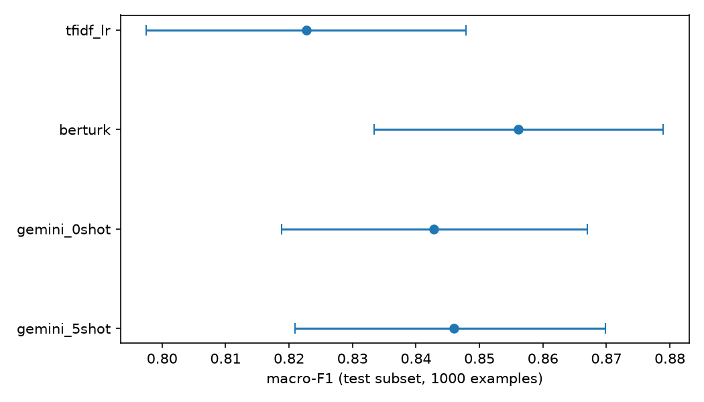
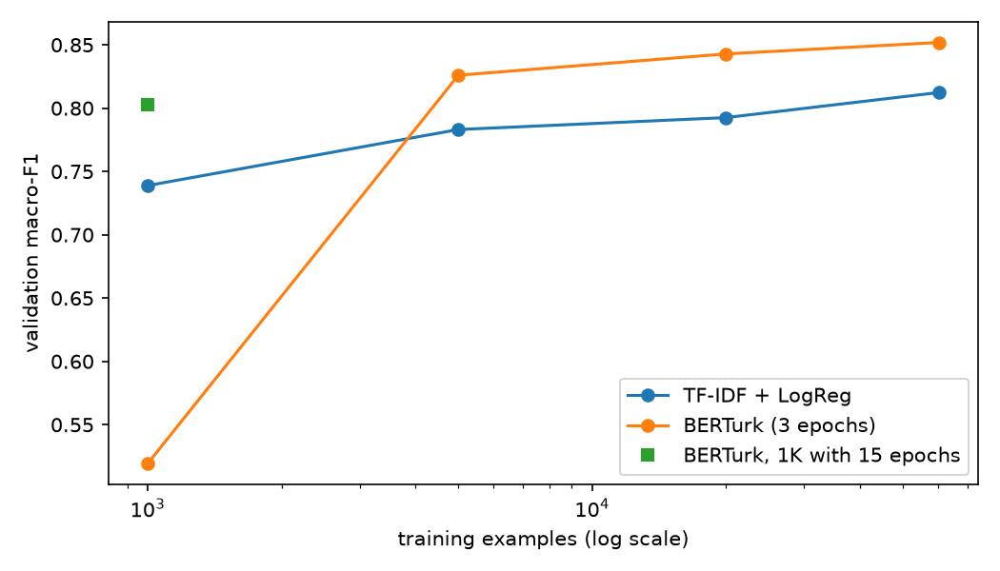
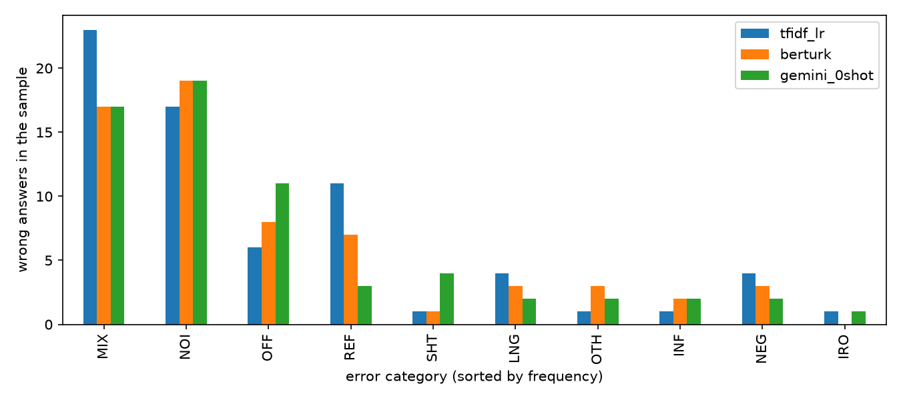

# trsent-bench

  

**Question:** On the same data and the same metrics, how do TF-IDF + Logistic Regression, a fine-tuned BERTurk model and a prompted LLM compare in accuracy, macro-F1, speed, cost and error types?

## Key findings

- **Fine-tuned BERTurk is the best model** (macro-F1 0.856) and is clearly better than TF-IDF + LogReg (0.823, McNemar p = 0.003).
- **The prompted LLM (Gemini 3.6 Flash, no training) lands in between** (0.843 to 0.846). On 1000 test examples it cannot be ranked against the other two.
- **More data helps both classical and neural models, but BERTurk leads at every size.** From 20K to 60K training examples it gains only 0.9 points for 2.7x the training time.
- **The prompt wording hardly matters here.** Four prompt variants differ by 0.013 macro-F1 on validation.
- **Many remaining errors are the labels' fault.** About 28% of sampled errors come from noisy labels (star ratings), not from the models.

This is a learning project: one dataset, one seed, one LLM. See [limitations](docs/LIMITATIONS.md) before quoting a number.

## Data

SentiTurca, `movies` config (Turkish movie reviews, binary: negative / positive). Official train / validation / test splits are used. Labels come from star ratings, so some of them are noisy. About 71% of the reviews are positive, so the primary metric is **macro-F1**, which weighs both classes equally.

Cleaning (details in `docs/DECISIONS.md`, D-014): 2 empty rows removed, 58 train rows that also appear in validation or test removed, 57 duplicates inside train removed. Train 60,294 / validation 8,905 / test 8,934 rows. The LLM is evaluated on a fixed random subset of 1000 test examples; the other models are evaluated on the same subset (for a fair comparison) and on the full test split.

## Results

Same 1000 test examples for all models. Macro-F1 with a 95% bootstrap interval.

| Model | Macro-F1 | 95% interval | Accuracy | Time / example | Cost for 1000 examples |
|---|---|---|---|---|---|
| Majority class (validation set) | 0.415 | n/a | 0.709 | n/a | 0 |
| TF-IDF + LogReg | 0.823 | 0.798 to 0.848 | 0.850 | 0.19 ms (CPU) | 0 (train 15 s) |
| BERTurk (fine-tuned, seed 42) | **0.856** | 0.833 to 0.879 | **0.882** | 18 ms (Apple MPS) | 0 (train 92 min) |
| Gemini 3.6 Flash, 0-shot | 0.843 | 0.819 to 0.867 | 0.866 | ~840 ms (API) | $0.13 |
| Gemini 3.6 Flash, 5-shot | 0.846 | 0.821 to 0.870 | 0.869 | ~770 ms (API) | $0.38 |

Full test split (8,934 examples): TF-IDF + LogReg 0.816, BERTurk 0.855.

- BERTurk vs TF-IDF is a real difference. The Gemini models cannot be separated from either on 1000 examples.
- Speed is not directly comparable: TF-IDF and BERTurk run locally on one Mac, Gemini speed is API latency.




### Learning curve (validation only)

| Training examples | TF-IDF + LogReg | BERTurk |
|---|---|---|
| 1,000 | 0.739 | 0.803 (15 epochs) |
| 5,000 | 0.783 | 0.826 |
| 20,000 | 0.793 | 0.843 |
| 60,294 (full) | 0.812 | 0.852 |



### Prompt sensitivity (validation only)

Gemini 3.6 Flash, 0-shot, 200 validation examples: v1 0.879, v2 0.872, v3 (English) 0.866, v4 ("one word") 0.879 macro-F1. No variant beat v1 by the 0.02 margin fixed in advance, so v1 stays.

### Error analysis

100 sampled errors, sorted by hand into categories. The biggest groups are mixed sentiment (29), label noise (19) and texts that are not opinions (17).



Longer notes, all tables and caveats: [docs/RESULTS.md](docs/RESULTS.md).

## Quick start

Python 3.12 (3.11+ should work). Pinned versions are in `requirements.txt`.

```bash
python -m venv .venv
source .venv/bin/activate
pip install -r requirements.txt   # torch and transformers are large downloads (several GB)
python src/05_compare.py          # rebuilds the main table from the saved predictions (no training, no API key)
```

## Reproduce everything

Run in this order (scripts are numbered by phase). Copy `.env.example` to `.env` and put your Gemini API key in `LLM_API_KEY` before the LLM steps.

```bash
# Data and baselines
python src/00_check_device.py                # which device PyTorch uses (cpu / mps / cuda)
python src/01_prepare_data.py                # downloads SentiTurca, cleans it, draws the 1000-example LLM subset
python src/01_majority_baseline.py
python src/02_tune_tfidf_lr.py               # validation only
python src/02_eval_tfidf_lr_test.py          # test split: run once

# BERTurk
python src/03_check_token_lengths.py         # picks max_length
python src/03_finetune_berturk.py 42         # about 90 minutes on an Apple M-series Mac, validation only
python src/03_eval_berturk_test.py 42        # test split: run once

# LLM (costs money, answers are cached)
python src/04_llm_classify.py validation zeroshot 200
python src/04_llm_classify.py validation fiveshot 200
python src/04_llm_classify.py test zeroshot 1000   # test subset: run once per prompt
python src/04_llm_classify.py test fiveshot 1000
python src/04_token_compare.py

# Comparison and error analysis
python src/05_compare.py
python src/05_sample_errors.py

# Bonus: prompt sensitivity (validation only, 3 x 200 calls)
python src/04_llm_classify.py validation zeroshot 200 fewshot_v2   # also fewshot_v3, fewshot_v4

# Bonus: learning curve (validation only)
python src/06_learning_curve_tfidf.py
python src/06_learning_curve_berturk.py 1000        # also 5000 and 20000
python src/06_learning_curve_berturk.py 1000 15     # 1000 examples, 15 epochs
python src/06_plot_learning_curve.py
```

Notes:
- Test split scripts are final evaluations. Tuning and prompt choice use validation only (`docs/EVAL_PROTOCOL.md`).
- LLM answers are cached in `results/llm_cache/`, so re-running a script does not pay twice. Output at temperature 0 is not guaranteed to be identical across runs.
- BERTurk training results can differ slightly between machines and library versions.
- Data and model checkpoints are not in the repository (`data/processed/`, `checkpoints/`). The scripts create them.

## Project structure

```
src/            numbered scripts per phase (00 setup, 01 data, 02 TF-IDF, 03 BERTurk, 04 LLM, 05 comparison, 06 learning curve)
src/config.py   all settings: seed, paths, model names, prices
notebooks/      01_eda.ipynb (data exploration), 02_error_analysis.ipynb (plots, error categories)
prompts/        fewshot_v1.md (the frozen LLM prompt) and the variants v2 to v4
docs/           PLAN, EVAL_PROTOCOL (the rules), DECISIONS (every decision and why), RESULTS, LIMITATIONS, ERROR_TAXONOMY
results/        metrics, predictions, comparison tables, plots, LLM cache
data/           llm_subset_ids.json, fewshot_ids.json (raw and processed data are git-ignored)
```

## Limitations

- One dataset (movie reviews), one BERTurk seed, one LLM, a 1000-example test subset (intervals about ±0.025).
- Labels are star ratings, so some are noisy. The LLM may have seen these reviews in pretraining.
- The learning curve and prompt check use validation only and one run.

Full list: [docs/LIMITATIONS.md](docs/LIMITATIONS.md).

## Data and model attribution

- Data: SentiTurca (`movies` config), turkish-nlp-suite, https://huggingface.co/datasets/turkish-nlp-suite/SentiTurca (the BüyükSinema dataset it is based on is CC BY-SA 4.0; check the SentiTurca card for its own license). `results/error_analysis.csv` and `results/error_sample_blind.csv` contain review texts from this dataset and fall under its license, not under the MIT license of the code.
- Model: BERTurk, `dbmdz/bert-base-turkish-cased`, MIT license, https://huggingface.co/dbmdz/bert-base-turkish-cased
- LLM: Gemini 3.6 Flash (`gemini-3.6-flash`) through the Google Gemini API.
- Code: MIT license, see `LICENSE`.
