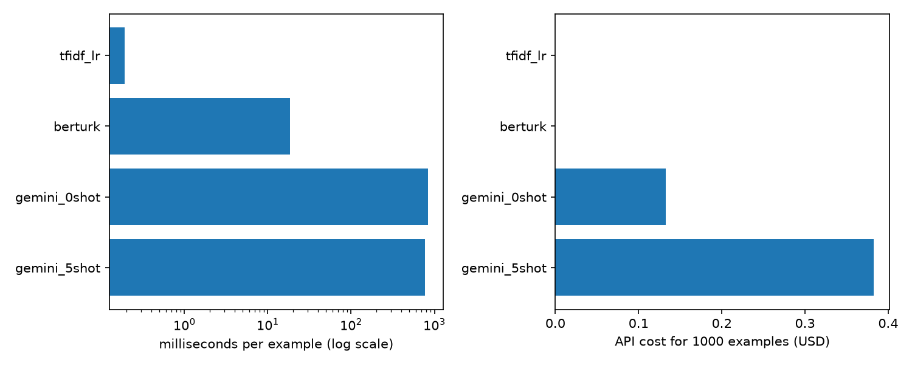

# trsent-bench

**Question:** For Turkish sentiment classification, how do TF-IDF + Logistic Regression, a fine-tuned BERTurk model and a prompted LLM compare in accuracy, macro-F1, speed, cost and the kinds of errors they make?

**Short answer:** Fine-tuned BERTurk is the best model (macro-F1 0.856) and is clearly better than TF-IDF + LogReg (0.823, p = 0.003). The prompted LLM (Gemini 3.6 Flash, no training) lands in between (0.843 to 0.846), but on 1000 test examples it cannot be ranked against the other two. A large share of the remaining errors comes from noisy labels (star ratings), not from the models.

This is a learning project: one dataset, one seed, one LLM. Read the limitations before quoting a number.

## Data

SentiTurca, `movies` config (Turkish movie reviews, binary: negative / positive). Official train / validation / test splits are used. Labels come from star ratings, so some of them are noisy. About 71% of the reviews are positive, so the primary metric is **macro-F1**, which weighs both classes equally.

Cleaning (details in `docs/DECISIONS.md`, D-014): 2 empty rows removed, 58 train rows that also appear in validation or test removed, 57 duplicates inside train removed. Train 60,294 / validation 8,905 / test 8,934 rows. The LLM is evaluated on a fixed random subset of 1000 test examples; the other models are evaluated on the same subset (for a fair comparison) and on the full test split.

## Results

Same 1000 test examples for all models. Macro-F1 with a 95% bootstrap interval (1000 resamples).

| Model | Macro-F1 | 95% interval | Accuracy | Time / example | Cost for 1000 examples |
|---|---|---|---|---|---|
| Majority class (validation set) | 0.415 | n/a | 0.709 | n/a | 0 |
| TF-IDF + LogReg | 0.823 | 0.798 to 0.848 | 0.850 | 0.19 ms (CPU) | 0 (train 15 s) |
| BERTurk (fine-tuned, seed 42) | **0.856** | 0.833 to 0.879 | **0.882** | 18 ms (Apple MPS) | 0 (train 92 min) |
| Gemini 3.6 Flash, 0-shot | 0.843 | 0.819 to 0.867 | 0.866 | ~840 ms (API latency) | $0.13 |
| Gemini 3.6 Flash, 5-shot | 0.846 | 0.821 to 0.870 | 0.869 | ~770 ms (API latency) | $0.38 |

Full test split (8,934 examples): TF-IDF + LogReg 0.816 (0.808 to 0.824), BERTurk 0.855 (0.847 to 0.862).

How to read this:
- **BERTurk vs TF-IDF:** a real difference (McNemar test p = 0.003, full test split intervals do not overlap).
- **Gemini vs the others:** not significant on 1000 examples (p between 0.10 and 0.20). With six pairwise tests, only the BERTurk vs TF-IDF result is treated as real.
- **0-shot vs 5-shot:** the same (p = 0.71), and 5-shot costs about 3x more input tokens. 0-shot was chosen as the main LLM setting on validation, before looking at test.
- Speed numbers are **not directly comparable**: TF-IDF and BERTurk run locally on one Mac (warm-up excluded, batch size 64 for BERTurk), Gemini speed is API latency and depends on the network. Gemini prices: $0.75 / $3.75 per 1M input / output tokens (checked on 2026-11-14).
- The majority class row is from the validation set (always predicts "positive").
- For the same Turkish text, Gemini's tokenizer needs about 30% more tokens than BERTurk's (2.03 vs 1.56 tokens per word, 100 validation reviews).




All numbers come from the files in `results/` (`comparison_table.csv`, `comparison_table_full_test.csv`, `pairwise_mcnemar.csv`).

## Error analysis

100 errors were sampled (35 where all three models are wrong, 40 where exactly one is wrong, 25 where two are wrong) from TF-IDF, BERTurk and Gemini 0-shot, and sorted into the categories in `docs/ERROR_TAXONOMY.md`. The category was assigned from the text and the true label, before looking at which model was wrong.

| Category | Count (primary) |
|---|---|
| Mixed sentiment (praise and criticism) | 29 |
| Label noise (text clearly disagrees with label) | 19 |
| Not about quality (plot summary, quote, question) | 17 |
| Needs outside context (other films, other reviews) | 12 |
| Short / low information | 5 |
| Long with sentiment shift | 5 |
| Informal writing | 4 |
| Negation | 4 |
| Other | 4 |
| Irony | 1 |

- Label noise counted as primary or secondary category: 28 of 100, and in 24 of those all three models are wrong. A good part of the shared errors is the label's fault, so no model can reach 100%.
- TF-IDF has more errors than the other two on mixed sentiment and on reviews that need outside context. Gemini has more errors on texts that are not opinions and on very short texts. The counts are small, treat this as a hint only.
- The sample is stratified, so the percentages describe this sample, not all errors. Plots: `results/plot_error_categories.png`. Table: `results/error_analysis.csv`. Notebook: `notebooks/02_error_analysis.ipynb`.

## Setup and reproduction

Python 3.12 (3.11+ should work). Pinned versions are in `requirements.txt`.

```bash
python -m venv .venv
source .venv/bin/activate
pip install -r requirements.txt   # torch and transformers are large downloads (several GB)
```

**Reproduce the main table** (no training, no API key; uses the saved predictions in `results/`):

```bash
python src/05_compare.py
```

**Reproduce everything from scratch**, in this order (each script is numbered by phase):

```bash
python src/00_check_device.py                # which device PyTorch uses (cpu / mps / cuda)
python src/01_prepare_data.py                # downloads SentiTurca, cleans it, draws the 1000-example LLM subset
python src/01_majority_baseline.py
python src/02_tune_tfidf_lr.py               # validation only
python src/02_eval_tfidf_lr_test.py          # test split: run once
python src/03_check_token_lengths.py         # picks max_length for BERTurk
python src/03_finetune_berturk.py 42         # about 90 minutes on an Apple M-series Mac, validation only
python src/03_eval_berturk_test.py 42        # test split: run once
# LLM: copy .env.example to .env and put your Gemini API key in LLM_API_KEY
python src/04_llm_classify.py validation zeroshot 200
python src/04_llm_classify.py validation fiveshot 200
python src/04_llm_classify.py test zeroshot 1000   # test subset: run once per prompt
python src/04_llm_classify.py test fiveshot 1000
python src/04_token_compare.py
python src/05_compare.py
python src/05_sample_errors.py
```

Notes:
- Test split scripts are final evaluations. Tuning and prompt choice use validation only (`docs/EVAL_PROTOCOL.md`).
- LLM answers are cached on disk (`results/llm_cache/`), so re-running a script does not pay twice. LLM output at temperature 0 is not guaranteed to be identical across runs.
- BERTurk training results can differ slightly between machines and library versions.
- Data and model checkpoints are not in the repository (`data/processed/`, `checkpoints/`). The scripts create them.

## Project structure

```
src/            numbered scripts per phase (00 setup, 01 data, 02 TF-IDF, 03 BERTurk, 04 LLM, 05 comparison)
src/config.py   all settings: seed, paths, model names, prices
notebooks/      01_eda.ipynb (data exploration), 02_error_analysis.ipynb (plots, error categories)
prompts/        fewshot_v1.md, the frozen LLM prompt
docs/           PLAN.md, EVAL_PROTOCOL.md (the rules), DECISIONS.md (every decision and why), ERROR_TAXONOMY.md
results/        metrics, predictions, comparison tables, plots, LLM cache
data/           llm_subset_ids.json, fewshot_ids.json (raw and processed data are git-ignored)
```

## Limitations

- **One dataset, one domain:** movie reviews only. Results may not transfer to other Turkish text.
- **One seed for BERTurk.** A 3-seed run was planned, but one run crashed when the disk was full and the rest was stopped. No standard deviation over seeds is reported. The one other seed that reached the end of training (validation macro-F1 0.8535 vs 0.8519 for seed 42) suggests the seed effect is small, but it was not evaluated on test.
- **Subset of 1000 test examples** for the model comparison, so the intervals are wide (about ±0.025). Small differences cannot be ranked.
- **One LLM, one prompt version, one run.** Gemini output through an API is not fully deterministic even at temperature 0. The prompt was tuned on 200 validation examples only.
- **The LLM may have seen these reviews during pretraining.** We cannot check this.
- **Weak labels:** star ratings, not human sentiment judgments. In the error sample, label noise appears in about 28% of the examples.
- **Error analysis:** one labeler (an AI assistant), no agreement score, stratified sample of 100, and long reviews were read only up to about 350 characters.
- **Train overlap removal:** removing train rows that also appear in validation or test used test texts for that one decision (`docs/DECISIONS.md`, D-014).
- **Speed numbers** come from one Mac and one network connection.

## Data and model attribution

- Data: SentiTurca (`movies` config), turkish-nlp-suite, https://huggingface.co/datasets/turkish-nlp-suite/SentiTurca (the BüyükSinema dataset it is based on is CC BY-SA 4.0; check the SentiTurca card for its own license). `results/error_analysis.csv` and `results/error_sample_blind.csv` contain review texts from this dataset and fall under its license, not under the MIT license of the code.
- Model: BERTurk, `dbmdz/bert-base-turkish-cased`, MIT license, https://huggingface.co/dbmdz/bert-base-turkish-cased
- LLM: Gemini 3.6 Flash (`gemini-3.6-flash`) through the Google Gemini API.
- Code: MIT license, see `LICENSE`.
